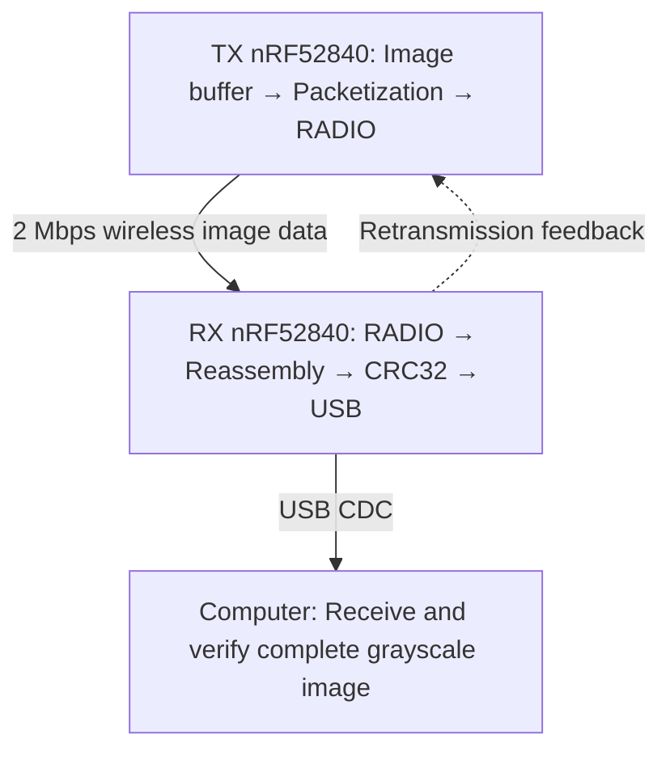

# nRF52840 Wireless Imaging

Send a grayscale image wirelessly between two small microcontrollers, then save
and verify it on a computer. The project uses **bare-metal C**: firmware controls
the hardware directly, without an RTOS (operating system) or BLE stack.

**Hardware:** Two Seeed XIAO nRF52840 boards, one transmitter (**TX**) and one
receiver (**RX**), with USB connections for programming and receiving the image.

**Current status:** Reliable image transfer is implemented through Milestone 4.1.
The image is currently generated in software. Actual **HM01B0 camera acquisition
is planned for Milestone 5**.

## Bare-Metal Wireless Communication Protocol

### 5-Step Communication Workflow

1. **Image acquisition:** TX stores a 320 × 320 grayscale image in SRAM (working
   memory). At one byte per pixel, the image occupies 102,400 bytes, or 102.4 KB.
   The current demo uses a synthetic test image.
2. **Packetization:** TX divides the image into **434 data packets**, each carrying
   up to **236 image bytes**, plus protocol metadata that identifies the frame
   and packet.
3. **Wireless transmission:** The nRF52840 RADIO peripheral sends packets at
   **2 Mbps** in the **2.4 GHz** band. Hardware timers and PPI (hardware event
   connections) schedule transmissions; EasyDMA moves packet data between memory
   and the radio.
4. **Error recovery:** RX tracks missing packets and asks TX to resend only those
   packets. This selective retransmission uses half-duplex feedback: the boards
   take turns sending and listening.
5. **Verification and USB transfer:** RX reassembles the image, checks its
   **CRC32 checksum** for corruption, and sends it to the computer over **USB CDC**
   (a USB serial connection). The computer checks the checksum and compares every
   pixel with the expected test image before saving it.



**Why bare metal?** Direct control of radio registers, hardware timers, DMA
buffers, and memory enables deterministic packet scheduling with minimal
software overhead.

### Measured Performance

| Metric | Result |
| --- | --- |
| Reliable wireless image transfer | ~535–555 ms in successful low-retry runs |
| Image integrity | 100% of pixels verified in those successful runs, plus CRC32 |
| TX packet spacing | 1,100 µs configured interval |
| Radio frequency | 2440 MHz |
| Error recovery and integrity checking | Selective retransmission + CRC32 |

The recorded successful wireless transfer times were **534.552 ms** and
**553.877 ms**. These are individual results, not a guaranteed timing range or
an overall success rate. Wireless timing excludes image generation and USB
transfer. The radio's 2 Mbps rate includes protocol overhead; it is not the
image delivery rate.

The baseline control profile is the starting point. Reduced-guard `balanced`
and `aggressive` profiles still require physical validation; see the
[validation guide](docs/radio-freeze.md).

## Get Started

### 1. Build and test

On macOS, install Make and a host C compiler (through Xcode Command Line Tools),
Python **3.12+**, and an ARM GCC toolchain with binutils and newlib:

```sh
xcode-select --install                 # If command-line tools are missing
brew install python
brew install --cask gcc-arm-embedded
make build
make test
```

The first build downloads pinned, SHA-256-verified TinyUSB, Nordic nrfx/MDK,
and ARM CMSIS dependencies. Later builds can run offline. `make build` builds
the default benchmark firmware; the image experiment below builds matching
image firmware automatically. Building and testing do not flash either board.

If needed, select a toolchain with
`make build CROSS_COMPILE=/absolute/path/to/bin/arm-none-eabi-`.
Run `make clean` when changing compilers or compiler flags.

### 2. Run an image transfer

Connect both boards by USB, double-press each board's reset button to enter UF2
bootloader mode, and close other serial monitors. Run this from an interactive
terminal in the repository:

```sh
./scripts/run_experiment.sh --mode image --frequency 2440 --interval-us 1100 --control-profile baseline
```

The runner builds the firmware, helps identify the physical RX and TX boards,
checks their flash layouts, and asks you to type `FLASH`. It programs RX first
and waits for it to be ready before programming TX. Identify boards through the
runner: USB mount names can change after reconnection.

Use `--interval-us 1500` as a conservative fallback. Omitting the interval also
uses 1500 µs with the baseline profile. Reset both boards before another run;
each run transfers one image.

### 3. Find the image and results

Results are saved in a timestamped directory under `experiments/`, including:

- **`image.pgm`** — the verified grayscale image, saved only after all checks pass.
- **`image.json` / `image.csv`** — image integrity and timing results.
- **`summary.json` / `summary.csv`** — the overall experiment outcome.
- **Logs, raw USB capture, and firmware files** — evidence for troubleshooting
  and reproducing the run.

See the [image transfer guide](docs/image-transfer.md) for standalone reception,
recovery behavior, and detailed timing definitions.

## Benchmark Mode

The separate benchmark mode measures a synthetic packet stream without image
reassembly or retransmission:

```sh
./scripts/run_experiment.sh --frequency 2440 --payload 240 --interval-us 1200 --packets 10000
```

See the [experiment guide](docs/experiments.md) for packet sizes, scheduling,
benchmark matrices, and telemetry.

## Project Guide

| Location | Contents |
| --- | --- |
| `tx/` and `rx/` | Transmitter and receiver firmware |
| `common/` | Shared radio, image protocol, timing, and USB code |
| `platform/` | Startup, memory layout, and USB descriptors |
| `scripts/` | Build support, flashing, experiments, and image reception |
| `tests/` | Host tests for protocol, timing, USB, and tooling |
| [Image transfer](docs/image-transfer.md) | Packet format, recovery, USB framing, and memory use |
| [Performance audit](docs/performance.md) | Timing analysis and optimization history |
| [Control timing audit](docs/control-audit.md) | Feedback timing and guard intervals |
| [Milestone 4.1 validation](docs/radio-freeze.md) | Experimental profiles and required hardware checks |
| [Validation history](docs/validation.md) | Software checks and hardware validation limits |
| [Flash layout](docs/layout.md) | Memory map and preserved bootloader/SoftDevice regions |

The firmware does not enable or call the installed SoftDevice. The flashing
tools preserve the existing bootloader and reserved flash regions.
